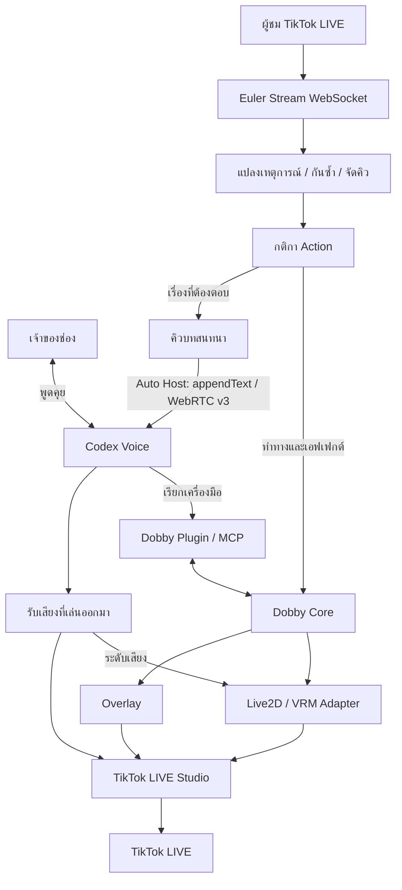

# Dobby — แผนระบบ AI VTuber สำหรับ Codex และ TikTok LIVE

วันที่: 19 พฤศจิกายน 2026
สถานะ: Desktop v0.5.0 เพิ่ม Auto Host ผ่าน Codex CLI/ChatGPT login โดยไม่ใช้ API key ทดสอบคอมเมนต์จำลอง → คำตอบภาษาไทย → เสียง Codex จริงจนจบแล้ว Euler รับคอมเมนต์จากช่องจริงได้ และภาพ output เคลื่อนไหวใน LIVE Studio แล้ว ยังต้องทดสอบคำตอบที่ผู้ชมไลฟ์ได้ยินและการใช้งานต่อเนื่อง
โปรแกรมออกอากาศที่ผู้ใช้เลือก: TikTok LIVE Studio

ตรวจเครื่องจริงแล้ว: TikTok LIVE Studio รุ่น 1.40.2 บน Mac จับหน้าต่าง `Dobby · LIVE output` ได้ ภาพเคลื่อนไหวเมื่ออยู่ด้านหลังหลังแก้ background throttling ใน v0.4.1 ผู้ใช้เริ่มไลฟ์เอง การทดสอบ Auto Host รอบพัฒนาแยกจากไลฟ์และปิดเสียงออกลำโพง

## 1. เป้าหมาย

Dobby เป็นแอป Desktop สำหรับสร้างตัวละคร AI ที่กำหนดบุคลิกได้ สนทนาผ่าน Codex Voice แสดงผลด้วย Live2D หรืออวตาร 3D และส่งภาพกับเสียงเข้า TikTok LIVE Studio เพื่อไลฟ์ TikTok โดยรับปฏิสัมพันธ์ผู้ชมผ่าน Euler Stream

เริ่มพัฒนาบน macOS ตามสภาพแวดล้อมปัจจุบัน และตรวจรุ่น TikTok LIVE Studio ที่ติดตั้งจริงก่อนเลือกวิธีจับภาพ/เสียง ออกแบบส่วนเชื่อมต่อให้เพิ่ม Windows ได้ภายหลัง ไม่สมมติว่ารายการ Sources และการรับเสียงเหมือนกันทุกแพลตฟอร์ม คำว่า 3D ในแผนนี้หมายถึงอวตาร เช่น VRM หากต้องการโปรแกรม Live3D โดยเฉพาะต้องตรวจสอบ API ของโปรแกรมนั้นเพิ่มเติม

ชื่อระบบคือ Dobby ส่วนคาแรกเตอร์ที่โหลดใช้งานเปลี่ยนชื่อและบุคลิกได้ ชื่อแอปจึงไม่ผูกกับตัวละครหนึ่งตัว

## 2. ข้อเท็จจริงและจุดที่ต้องทดลอง

| เรื่อง | สถานะ | ผลต่อการออกแบบ |
|---|---|---|
| Voice Chat ใน Codex | เอกสารทางการรองรับใน Desktop สำหรับบัญชีที่มีสิทธิ์ | ใช้เป็นช่องทางพูดคุยกับเจ้าของช่องได้ |
| Plugin และ MCP | รองรับเครื่องมือและ Skills | ใช้สั่งสีหน้า ท่าทาง และอ่านบริบท Dobby |
| Plugin รับเสียง Voice โดยตรง | ยังไม่ยืนยัน | แยกการรับเสียงออกจาก MCP และทดลองจับเสียงระดับระบบ |
| เหตุการณ์ภายนอกทำให้ Codex ตอบด้วยเสียง | ผ่านคอมเมนต์จำลองกับ Codex CLI 0.165.0 / WebRTC v3 | ใช้ appendText ในเซสชัน host แยกจาก appendSpeech สำหรับอ่านข้อความ |
| App Server | รองรับการฝัง Codex ในแอปและสตรีมเหตุการณ์สนทนา | เป็นตัวเลือกเชื่อมสมอง แต่ไม่ถือว่าได้ Native Voice เดิมมาด้วยอัตโนมัติ |
| Euler Stream WebSocket | มี API key/JWT และเลือกช่องด้วย uniqueId | ใช้รับเหตุการณ์ผู้ชมโดยตรง ไม่ต้องผ่าน Codex ทุกเหตุการณ์ |
| Live2D ภายใน Dobby | นำเข้าคลัง 13 โมเดลจากพาธผู้ใช้ ทดสอบแสดงผลและสลับ Haru/Hiyori ได้ | ใช้ renderer ภายในแอปและหน้า output พร้อม mapping ต่อโมเดล |
| VRM | มีมาตรฐาน Expressions และรูปปาก | เพิ่มตัวแสดงผล 3D ภายหลัง |
| ส่งไลฟ์ผ่าน TikTok LIVE Studio | ผู้ใช้กำหนดให้เป็นโปรแกรมออกอากาศหลัก พบรุ่น 1.40.2 เปิดหน้าแรกได้บน Mac เครื่องนี้ | ทดสอบแหล่งภาพตัวละคร เสียง และ Link source ต่อในรุ่นนี้ |
| ช่องทางออกอากาศ TikTok ของบัญชีจริง | ยังไม่ได้ตรวจบัญชี | ตรวจว่าบัญชีลงชื่อเข้าใช้และออกอากาศผ่าน LIVE Studio ได้ |

Euler Stream API key ใช้เข้าถึงข้อมูลผู้ชม ไม่ใช่ข้อมูลลงชื่อเข้าใช้ TikTok LIVE Studio และไม่ได้เปิดสิทธิ์ออกอากาศให้บัญชี การได้รับข้อมูลผู้ชมกับการส่งภาพเสียงเป็นคนละการเชื่อมต่อ แผนนี้ไม่กำหนดให้ผู้ใช้ต้องหา RTMP/Stream Key แยกก่อนเริ่มออกแบบ แต่ตรวจขั้นตอนที่บัญชีและรุ่น LIVE Studio ต้องใช้จริง

## 3. ภาพรวมระบบ



เส้นประคือความสามารถที่ยังต้องพิสูจน์ ไม่ใช่การเชื่อมต่อที่ทดสอบแล้ว การขยับปากต้องทำในวงรอบเสียง/แอนิเมชันของแอป ไม่เรียกโมเดลผ่าน MCP ทุกเฟรม

## 4. โหมดการทำงาน

### Companion — คุยกับเจ้าของช่อง

เจ้าของช่องเปิด Voice Chat ใน Codex และเปิด Dobby ควบคู่กัน Codex ใช้เครื่องมือ Dobby เปลี่ยนสีหน้าหรือท่าทาง แอปรับเสียงที่เล่นออกมาเพื่อขยับปาก และส่งภาพเสียงเข้า TikTok LIVE Studio

เวอร์ชันแรกยังเปิด Voice จาก Codex เอง ไม่สมมติว่า Plugin สามารถกดเปิด Voice หรือเปลี่ยนเสียงประจำบัญชีได้

### Interactive LIVE — ผู้ชมควบคุม Action

Euler Stream ส่งเหตุการณ์เข้า Dobby กติกาที่ตั้งไว้เลือกท่าทาง เอฟเฟกต์ และข้อความบนจอได้ทันที ส่วนที่ต้องพูดส่งเข้าคิวแยก หาก Native Voice ยังเริ่มตอบเองไม่ได้ เจ้าของช่องเลือกคำถามจากคิวแล้วสั่ง Codex ทางเสียง

### Auto Host — พิธีกรตอบผู้ชมเอง

เป้าหมายคือเลือกคอมเมนต์ สร้างคำตอบในบุคลิก และพูดได้โดยไม่ต้องให้เจ้าของช่องสั่งแต่ละครั้ง

ทำได้แล้วใน v0.5.0: ใช้ Codex app-server experimental ผ่าน CLI ที่ล็อกอินด้วย ChatGPT ส่งผู้ชมเป็น JSON ที่ไม่เชื่อถือผ่าน appendText และรับเสียง WebRTC v3 รอเล่นจบก่อนจบงาน/รับงานถัดไป ไม่ใช้ OpenAI API key เปิดจากปุ่มเริ่มตอบไลฟ์อัตโนมัติหลังเชื่อม Euler เท่านั้น หยุดเมื่อเสียงหรือ Euler หลุด และไม่เปิดเองเมื่อเริ่มแอป

ไม่ใช้การเปิดเสียงสังเคราะห์ใส่ไมโครโฟนหรือกด UI ซ้ำเป็นโครงสร้างหลักของโหมดอัตโนมัติ

## 5. ส่วนประกอบ

| ส่วน | หน้าที่ |
|---|---|
| Dobby Desktop | หน้าตั้งค่า คาแรกเตอร์ การเชื่อมต่อ คิว และ Preview |
| Dobby Core | เก็บสถานะตัวละครและประสานงาน Action |
| Dobby Plugin | Skills สำหรับการใช้ตัวละครและ MCP tools |
| Euler Connector | เชื่อมช่อง รับเหตุการณ์ แสดงสถานะ และ reconnect |
| Event Pipeline | แปลงข้อมูล กันซ้ำ รวมเหตุการณ์ และจัดคิว |
| Action Engine | จับคู่เหตุการณ์กับท่าทาง สีหน้า เอฟเฟกต์ หรือคำขอสนทนา |
| Conversation Adapter | เชื่อมการสนทนากับ Codex หรือผู้ให้บริการเสียงที่เลือก |
| Audio Adapter | รับเสียง วัดระดับเสียง และส่งข้อมูลให้ lip sync |
| Avatar Adapter | คำสั่งกลางสำหรับ Live2D และ 3D |
| Broadcast Output | ภาพตัวละครและ overlay สำหรับ TikTok LIVE Studio |
| Scene Store | ขนาดฉากและพื้นหลังร่วมกันสำหรับ preview/output เก็บการตั้งค่าในเครื่อง |
| Local Store | โปรไฟล์ กติกา ความจำที่บันทึก และประวัติเหตุการณ์ |

เทคโนโลยีตั้งต้นที่เสนอ: Electron + TypeScript + React สำหรับ Desktop และ Node.js สำหรับ Core/MCP/Euler ใช้ SQLite เก็บข้อมูลภายในเครื่อง ตัวจับเสียง macOS เลือกหลังทำต้นแบบ อาจใช้ native helper หากต้องแยกเสียงเฉพาะโปรเซส

Live2D แสดงใน Dobby โดยตรงผ่าน PixiJS และ Cubism renderer นำเข้าไฟล์ .model3.json พร้อมทรัพยากรที่อ้างอิงจากชุดโมเดล อ่านไฟล์ต้นฉบับอย่างเดียว สลับโมเดล ปรับขนาด/ตำแหน่ง/กลับด้าน และเล่น motions/expressions ได้ เก็บการตั้งค่าและ Action mapping แยกต่อโมเดล Cubism Core นำเข้าสำหรับใช้ในเครื่อง ส่วน 3D เสนอ VRM renderer เป็น adapter ถัดไป ท่าทางจริงขึ้นกับไฟล์ที่แต่ละโมเดลมี

## 6. คาแรกเตอร์

โปรไฟล์ประกอบด้วยชื่อ ประวัติ บุคลิก สรรพนาม ภาษา คำติดปาก ตัวอย่างบทสนทนา วิธีตอบผู้ชม ท่าทาง และแหล่งเสียง

ตัวอย่างโปรไฟล์เริ่มต้น:

```json
{
  "id": "dobby-default",
  "name": "Dobby",
  "language": "th",
  "personality": ["เป็นกันเอง", "ขี้เล่น", "ช่างสงสัย"],
  "speakingStyle": "ตอบกระชับ อ่านชื่อผู้ชมอย่างเป็นธรรมชาติ",
  "responseLength": "1-3 ประโยค",
  "defaultExpression": "neutral",
  "voiceMode": "codex-native"
}
```

ข้อมูลนี้เป็นรูปแบบตั้งค่าที่เสนอสำหรับ Dobby ไม่ใช่ schema ของ Codex การเปลี่ยนบุคลิกต้องนำคำสั่งไปใช้ในแชตหรือ session ที่เกี่ยวข้อง การเปลี่ยนข้อมูลในไฟล์อย่างเดียวไม่ได้เปลี่ยน Voice session ที่กำลังทำงานโดยอัตโนมัติ

เริ่ม session โดยโหลดโปรไฟล์และบริบทที่จำเป็น ผ่าน Skill/เครื่องมือที่รองรับ ทดสอบความต่อเนื่องของบุคลิกทั้งการคุยทั่วไปและตอบคอมเมนต์ การกำหนดบุคลิกกับการเลือกเนื้อเสียงเป็นคนละเรื่อง เสียง Native เลือกตามตัวเลือกที่ Codex รองรับ

ความจำ Dobby เก็บแยกจากประวัติ Codex บันทึกสิ่งที่ถูกส่งมาให้แอปเท่านั้น ไม่สมมติว่า Plugin เห็นประวัติหรือบทถอดเสียงทั้งหมดของแชต

## 7. Euler Stream และ Action ผู้ชม

ตั้งค่าจากหน้า Connections ด้วย API key และ TikTok username เชื่อม WebSocket ของ Euler Stream ใช้ SDK/schema ปัจจุบันเพื่อแปลงข้อมูล ไม่ใช้ REST endpoint ชื่อ TikTok LIVE Events สำหรับรับคอมเมนต์ เพราะ endpoint นั้นเป็นรายการ LIVE event ที่จัดกำหนดการ

| เหตุการณ์ | Action ตัวอย่าง | แนวทางตั้งต้น |
|---|---|---|
| Comment | เลือกคำถามให้ Dobby ตอบ | กรองข้อความและเข้าคิวพูด |
| Gift | ทำหัวใจ โค้งขอบคุณ แสดงชื่อผู้ส่ง | แสดงผลทันที พูดขอบคุณผ่านคิว |
| Like | เพิ่มแถบพลังหรือเอฟเฟกต์ | รวมตามช่วงเวลา ไม่ตอบทุกไลก์ |
| Follow | โบกมือและขึ้นชื่อผู้ติดตาม | ตั้ง cooldown และตรวจชนิด event จริง |
| Join | แสดงข้อความต้อนรับ | สุ่มหรือรวมกลุ่มเมื่อคนเข้าเยอะ |
| คำสั่งใน Comment เช่น !หัวใจ | เล่นท่าที่ตั้งไว้ | ใช้รายการคำสั่งที่อนุญาตและ cooldown |

รายการนี้เป็นกติกาที่ Dobby จะตั้งให้ ไม่ใช่การรับรองว่า event ทุกชนิดส่งครบในทุกห้องและทุกแพ็กเกจ ตรวจข้อมูลจริงจาก SDK และช่องที่จะใช้งานก่อนเปิดกติกานั้น

ข้อมูลกลางที่เสนอ: sessionId, eventId, type, viewerId, displayName, receivedAt และ payload เฉพาะชนิด เก็บ ID เป็นสตริง ห้ามผูกโค้ดธุรกิจกับชื่อ field ที่ยังไม่ตรวจจาก schema จริง

ของขวัญแบบคอมโบต้องแยกสถานะอัปเดตกับจำนวนที่เพิ่มขึ้น ไม่รวมยอดสะสมซ้ำทุกแพ็กเก็ต ทดสอบ event ซ้ำ ระหว่างคอมโบ หลังคอมโบ และหลัง reconnect ก่อนเปิด Action ของขวัญจริง

## 8. คิวและการควบคุมไลฟ์

แยกคิวแอนิเมชันออกจากคิวพูด เพื่อให้เอฟเฟกต์สั้นทำงานได้ระหว่างที่ตัวละครพูด มีผู้พูดอัตโนมัติเพียงหนึ่งงานต่อครั้ง

ค่าตั้งต้นที่เสนอและต้องปรับจากการทดลอง:

- คิวพูดสูงสุด 20 งาน งานหมดอายุภายใน 30 วินาที
- รวมไลก์ทุก 2 วินาที และขอบคุณผู้ติดตามเป็นกลุ่มได้
- คำถามผู้ชมต่อคนมี cooldown เริ่มต้น 15 วินาที
- เจ้าของช่องแทรกคำสั่งได้ก่อนคิวอัตโนมัติ งานของขวัญแทรกระหว่างประโยคแทนตัดเสียงกลางคำ
- จัดความเป็นธรรมไม่ให้ของขวัญต่อเนื่องทำให้คำถามทั่วไปไม่ได้ตอบเลย
- ยกเลิกเสียงและคิวของ session เก่าเมื่อหยุด LIVE หรือเปลี่ยนช่อง
- reconnect แบบหน่วงเพิ่มและสุ่มระยะเวลา ป้องกันการเชื่อมต่อถี่เกินไป
- กันซ้ำด้วย event ID/ข้อมูลคอมโบตาม schema จริง ไม่รับรองการกู้คืนเหตุการณ์ที่ผู้ให้บริการไม่ได้ส่งย้อนหลัง

หน้า LIVE Console มีสถานะ Euler/Codex/เสียง/อวตาร คิวตอบ ผู้ส่งของขวัญล่าสุด ปุ่มเลือกคำถาม ข้ามคำตอบ หยุด Auto Host ปิดเสียง และหยุด Action

ข้อความจากผู้ชมใช้เป็นเนื้อหาสนทนาและคำสั่ง Action ที่กำหนดไว้ ไม่แปลงเป็นคำสั่ง shell หรือสิทธิ์ควบคุมเครื่องของเจ้าของช่อง

## 9. Plugin และ MCP ที่เสนอ

| Tool | การทำงาน |
|---|---|
| get_status | อ่านสถานะ Dobby และการเชื่อมต่อ |
| get_character | โหลดบุคลิกและบริบทสำหรับแชต |
| set_character | เลือกโปรไฟล์ที่มีอยู่และคืนคำสั่งบุคลิกให้ใช้ต่อ |
| perform_action | เล่นสีหน้า/ท่าทาง/เอฟเฟกต์ที่ลงทะเบียนไว้ |
| get_live_context | อ่านสรุปห้องและคิวผู้ชมล่าสุดแบบจำกัดขนาด |
| claim_reply | จองงานตอบหนึ่งงานไม่ให้ตอบซ้ำ |
| finish_reply | แจ้งว่างานตอบเสร็จหรือถูกยกเลิก |
| remember | บันทึกข้อมูลที่ต้องการจำให้ Dobby |

เครื่องมืออ่านคิวช่วยให้ Codex ดึงเหตุการณ์ไปใช้ แต่ไม่ใช่กลไก push ที่รับรองว่า Voice จะตื่นมาตอบเอง ต้องแยกทดสอบ event delivery, เริ่มคำตอบ และเสียงที่ออกจริง

Plugin ไม่มีเหตุผลต้องสร้างเสียงพูดซ้ำใน Companion mode เพราะ Codex Voice พูดอยู่แล้ว การรองรับผู้ให้บริการเสียงเพิ่มเติมอยู่ที่ Conversation/Audio Adapter

## 10. ภาพและเสียงสำหรับ TikTok

ใช้ TikTok LIVE Studio เป็นโปรแกรมออกอากาศหลัก ฉากเริ่มต้นเป็นแนวตั้ง 1080 × 1920 และปรับเป็น 16:9, 1:1 หรือความละเอียดกำหนดเองได้แล้ว preview และ output ใช้กรอบสัดส่วนเดียวกัน พื้นหลังเลือกโปร่งใส สีพื้น ไล่สี รูปภาพ หรือวิดีโอเล่นวนแบบปิดเสียงได้ ตั้ง 30 fps เป็นเป้าทดลองและปรับตามเครื่องกับ LIVE Studio รุ่นจริง

- ภาพ Live2D: ใช้หน้า output ของ Dobby ที่แสดงโมเดล .model3.json จริง ตัวเลือกสำรองคือจับหน้าต่าง output ของ Dobby ทดสอบ WebGL/พื้นหลังโปร่งใสใน LIVE Studio รุ่นจริง
- ภาพ overlay: ให้ Dobby เปิด URL หน้าแสดงผล แล้วนำไปเพิ่มเป็น Link source ใน LIVE Studio หากรุ่นที่ใช้รองรับ มีชื่อผู้ชม เอฟเฟกต์ และแถบเป้าหมาย
- ภาพ 3D/renderer ภายใน Dobby: เพิ่มเป็น Link source หรือจับหน้าต่างแสดงผลภายหลัง ต้องทดสอบ WebGL/ความโปร่งใสในตัวแสดงหน้าเว็บของ LIVE Studio ก่อนเลือกเส้นทางถาวร
- เสียง Codex Voice: เลือกเสียงจากแอปที่เล่นเสียงเมื่อระบบรองรับ หรือใช้ audio routing ตามแพลตฟอร์ม แล้วตั้งเสียงเข้า LIVE Studio เพียงทางเดียว
- แหล่งเสียงที่ใช้ขยับปากต้องเป็นเสียงตัวละคร ไม่ใช่ไมค์เจ้าของช่องหรือเสียงเพลงรวม
- lip sync ระยะแรกใช้ระดับเสียงเปิดปิดปาก ไม่รับรองความตรงระดับรูปปากตามหน่วยเสียง
- คำบรรยายเฉพาะประโยคที่ Dobby มีข้อความจริง ไม่สร้างคำบรรยายจากการคาดเดาว่า Voice พูดอะไร
- ลงชื่อเข้าใช้และเริ่มออกอากาศจาก TikTok LIVE Studio ตรวจสิทธิ์บัญชีจริงก่อนทดลองส่ง LIVE

บน macOS ต้องทดสอบการรับเสียงกับโปรเซสที่เล่นเสียง Codex จริง การรับเสียงใน LIVE Studio สำเร็จไม่ได้แปลว่า Dobby ได้ PCM สำหรับขยับปากแล้ว จึงตรวจทั้งสองเส้นทางแยกกัน ไม่สมมติว่าแหล่งภาพมีเสียงมาด้วย และไม่เปิดเสียงตัวละครซ้ำทั้งจากแหล่งแอปกับ Link source

### ลำดับตั้งค่าฉาก LIVE Studio ที่เสนอ

1. เปิด Dobby เลือกคาแรกเตอร์และโมเดลในหน้าโมเดล Live2D ตรวจภาพใน preview แล้วเปิดหน้า output
2. เปิด LIVE Studio เลือกฉากแนวตั้ง และเพิ่มแหล่งภาพอวตาร
3. เพิ่ม URL overlay ของ Dobby ผ่าน Link source ถ้ามีในรุ่นที่ใช้ ตั้งขนาดให้ตรงฉากและตรวจพื้นหลังโปร่งใส หากไม่มีให้ใช้หน้าต่าง output ของ Dobby ที่รวม overlay ไว้แล้ว
4. เพิ่มเสียงตัวละครและไมค์เจ้าของช่องเป็นคนละแหล่งเมื่อทำได้ ทดสอบว่าปิดไมค์แล้วเสียงตัวละครยังออก และเสียงเพลงไม่ทำให้ปากตัวละครขยับ
5. เชื่อม Euler ด้วยชื่อช่องที่จะออกอากาศ ตั้งกติกาและทดสอบด้วย event จำลองก่อนรับ event จริง
6. ทดสอบภาพและเสียงใน Preview และบันทึกคลิปด้วยฟังก์ชันที่รุ่น LIVE Studio รองรับ หรือเครื่องมืออัดผลทดสอบแยก จากนั้นตรวจเสียงซ้ำและการซิงก์ปาก
7. เมื่อบัญชีพร้อมและผู้ใช้เริ่ม LIVE ให้ตรวจรับ event จากห้องจริงและยืนยันผลจากฝั่งผู้ชม

### ข้อกำหนดของ Broadcast Output

- แยกหน้า operator ที่มีการตั้งค่ากับหน้า output สำหรับออกอากาศ ไม่แสดง API key หรือหน้าควบคุมบนไลฟ์
- เมื่อเปิดอยู่เครื่องเดียวกัน ให้เริ่มจาก URL ภายในเครื่อง พร้อมทดสอบว่า Link source เข้าถึงได้จริง ถ้าแยกเครื่องต้องเพิ่มการเชื่อมต่อที่ตรวจสิทธิ์แยก ไม่เปิดหน้าตั้งค่าให้เข้าถึงผ่านเครือข่าย
- หน้า output อ่านสถานะล่าสุดและเชื่อมกลับได้เมื่อ source โหลดใหม่ โดยไม่เล่นของขวัญเก่าหรือสร้างงานตอบซ้ำ
- ทดสอบสลับฉาก ซ่อน/แสดง source และเปลี่ยน layout ว่าสถานะอวตารยังถูกต้อง
- ในต้นแบบแรกเลือกหนึ่งเส้นทางภาพกับหนึ่งเส้นทางเสียงที่ผ่านการทดสอบ แล้วบันทึกเป็น preset ของเครื่อง

## 11. ข้อมูลและกุญแจเชื่อมต่อ

เก็บ Euler API key ผ่านหน้าตั้งค่าในเครื่องและคลังข้อมูลลับของระบบปฏิบัติการ ให้ backend/main process เป็นผู้เชื่อมต่อ ไม่ส่ง key เข้า LIVE Studio overlay, renderer หรือ log ของ URL

โหมด Native Voice ใช้การลงชื่อเข้าใช้ Codex ที่ผู้ใช้มี ไม่สรุปว่าใช้งานเสียงได้ไม่จำกัด ส่วนค่า Euler และผู้ให้บริการเสียงสำรองขึ้นกับแผนบริการที่เลือก ตรวจหลังวัดจำนวนเหตุการณ์และเวลาพูดจริง

## 12. แผนพัฒนาและเกณฑ์ผ่าน

### ระยะ 0 — พิสูจน์เส้นทางสำคัญ

สิ่งที่ทำ:

1. ตรวจรุ่นแอป บัญชี Voice ระบบปฏิบัติการ และ Sources/สิทธิ์ออกอากาศของ TikTok LIVE Studio ที่ใช้จริง
2. ทำเครื่องมือ Dobby ทดลองหนึ่งตัว และเรียกได้จากทั้งข้อความและ Voice
3. รับเสียงตัวละครจริง แสดงมิเตอร์ และขยับปากโมเดลทดสอบ
4. รับ Euler event จริงจากห้อง LIVE และบันทึกตัวอย่างที่ตัดข้อมูลลับแล้ว
5. ตรวจว่า event ภายนอกเริ่ม Native Voice response ได้ด้วยวิธีที่รองรับหรือไม่
6. ทดสอบ output ของ TikTok LIVE Studio และอัดหลักฐานภาพ เสียง และ Action รวมถึงทดสอบ Link source โหลดใหม่และสลับฉาก

ผลส่งมอบ: ตารางผ่าน/ไม่ผ่านพร้อมหลักฐาน และข้อสรุปว่าจะใช้ Native Voice สำหรับ Auto Host ได้หรือใช้เฉพาะ Companion หาก Native Voice ทำได้เฉพาะเจ้าของช่องพูดคุย ต้องระบุให้ชัดและเลือกเส้นทางเสียงสำรองก่อนพัฒนา Auto Host

### ระยะ 1 — Interactive LIVE MVP

สิ่งที่ทำ: Dobby Desktop, Euler Connector, Action Engine, คิว, การตั้งคาแรกเตอร์, Live2D ภายใน Dobby, คลังโมเดล, overlay และ Plugin ใช้กับ Codex Voice

เกณฑ์ผ่าน:

- เลือกคาแรกเตอร์และทดสอบเปลี่ยนสีหน้าได้
- คุยกับ Codex Voice แล้วตัวละครขยับปากจากเสียงจริง
- คอมเมนต์/ของขวัญเข้า Console และ Action ที่ตั้งไว้ทำงาน
- คอมโบของขวัญและ event ซ้ำไม่ทำให้ทำงานซ้ำเกินกติกา
- Preview ภาพแนวตั้งใน TikTok LIVE Studio ได้ และมีคลิปตรวจภาพ/เสียงจากเส้นทาง output ที่เลือก
- ปิดรับ Action หรือล้างคิวได้จากหน้า Console

### ระยะ 2 — Auto Host

ใช้ผลระยะ 0 เลือกเส้นทางสนทนา เพิ่มการเลือกคำถาม ตอบในบุคลิก ขอบคุณของขวัญ จัดคิวเสียง และควบคุมให้เจ้าของช่องแทรกได้

เกณฑ์ผ่าน: คอมเมนต์จริงหนึ่งข้อความทำให้ตัวละครตอบด้วยเสียงได้โดยไม่มีคนพิมพ์หรือสั่งซ้ำ ตอบผู้ชมหลายคนโดยไม่ซ้อนเสียง และหยุดคิวได้จริง ทดสอบต่อเนื่องอย่างน้อย 60 นาที พร้อมจำลอง event ซ้ำ เน็ตขาด คิวล้น และเสียงหยุดกลางทาง

### ระยะ 3 — อวตารในแอปและการใช้งานประจำ

ต่อยอด renderer ภายใน Dobby เพิ่ม VRM, preset ฉาก, ส่งออก/นำเข้าคาแรกเตอร์ และแพ็กเกจติดตั้ง จากนั้นทดสอบ LIVE จริงในบัญชีที่พร้อมออกอากาศ

การเพิ่ม 3D ต้องคง event และกติกา Action เดิมได้โดยเปลี่ยนเฉพาะ Avatar Adapter หากโมเดลไม่มีท่าที่ร้องขอให้แสดงผลสำรองที่กำหนดไว้

เพิ่มในต้นแบบ v0.3.0: ฉากร่วมสำหรับ preview/output พร้อม ratio 9:16, 16:9, 1:1 และกำหนดเอง รวมถึงพื้นหลังโปร่งใส สีพื้น ไล่สี รูปภาพ PNG/JPG/WebP และวิดีโอ MP4/WebM เล่นวนแบบปิดเสียง

## 13. การวัดผล

บันทึกเวลาแยกเป็น received → queued → started → first audio → completed เพื่อแยกความหน่วง Euler, คิว, AI และการเล่นเสียง

เป้าหมายทดลอง ไม่ใช่การรับรองจากผู้ให้บริการ:

- Action ที่ไม่ต้องใช้ AI เริ่มแสดงภายใน 500 ms หลัง Dobby รับ event ในสภาพทดสอบ
- ตรวจ lip sync จากคลิปที่อัดจริง และพยายามให้คลาดไม่เกิน 150 ms
- วัดเวลาจากเลือกคำถามถึงเริ่มพูดและรายงาน p50/p95 ก่อนตั้งเป้าความเร็ว Auto Host
- ทดสอบ burst ด้วย event จำลอง ตรวจว่าคิวมีขอบเขต ไม่ค้าง และปุ่มควบคุมยังตอบสนอง
- วัด CPU/GPU และความลื่นขณะเปิด Codex + Dobby + อวตาร + TikTok LIVE Studio พร้อมกัน

## 14. ลำดับเริ่มลงมือ

เริ่มจากการทดลอง Voice → MCP, Euler → Action และเสียง → ปาก ให้ครบสามเส้นทาง แล้วจึงทำ Desktop Console และแพ็กเกจ Plugin เต็มรูปแบบ

ยังไม่ต้องส่ง API key ในแชต ช่วงพัฒนาจะทำช่องตั้งค่าในเครื่องก่อน ข้อมูลที่ต้องใช้เมื่อถึงการทดสอบจริงคือโมเดลอวตาร ช่อง TikTok ที่เปิด LIVE ได้ และ Euler key ที่เจ้าของเครื่องกรอกเอง

## แหล่งอ้างอิง

- [Codex/ChatGPT Voice](https://learn.chatgpt.com/docs/features/voice)
- [Plugins และ MCP](https://learn.chatgpt.com/docs/plugins)
- [Codex App Server](https://learn.chatgpt.com/docs/app-server)
- [Euler Stream WebSocket API](https://www.eulerstream.com/docs/api/tiktok-web-socket-api)
- [Euler Stream WebSocket SDK](https://www.eulerstream.com/docs/api/client-sdks/websocket-sdk)
- [Euler Stream Quickstart](https://www.eulerstream.com/docs/api/quickstart)
- [Cubism SDK for Web](https://docs.live2d.com/en/cubism-sdk-manual/cubism-sdk-for-web/)
- [pixi-live2d-display](https://github.com/guansss/pixi-live2d-display)
- [VRM Expressions](https://vrm.dev/en/vrm1/expression/)
- [TikTok LIVE Studio Download](https://www.tiktok.com/studio/download) — จุดตรวจรุ่นและระบบที่รองรับ เว็บไซต์ไม่เปิดให้อ่านผ่านเครื่องมือค้นหาที่ใช้ในรอบนี้ จึงยังไม่ยืนยันรายการฟังก์ชันของรุ่นที่ติดตั้งจริง
- [TimerBox: ทดสอบ Link source ใน TikTok LIVE Studio](https://timerbox.app/stream/tiktok/) — เอกสารการทดสอบโดยผู้พัฒนา overlay บน Mac เดือนกันยายน 2026 ยืนยันเฉพาะสิ่งที่ผู้พัฒนาทดสอบ ไม่ใช่การรับรองจาก TikTok และยังไม่ยืนยันเสียงหรือผลออกอากาศจริงของ Dobby
- [Apple ScreenCaptureKit](https://developer.apple.com/documentation/screencapturekit/capturing-screen-content-in-macos)
- [Electron desktopCapturer](https://www.electronjs.org/docs/latest/api/desktop-capturer/)

ต้นแบบ v0.4.0 เพิ่มหน้าเสียงพูดผ่าน Codex CLI/ChatGPT login โดยไม่ใช้ API key เลือกเสียงแบบการ์ด โหลดรายการจาก thread/realtime/listVoices ใช้ WebRTC v3 และ appendSpeech พร้อมเครื่องมือ get_voice_status, speak_text, stop_speaking ส่วน Auto Host กับเสียงออกอากาศจริงยังต้องทดสอบต่อ


## ผลทดสอบ v0.5.0 — Auto Host

- คอมเมนต์จำลอง Mochi เข้าคิว แล้ว Codex สร้างคำตอบภาษาไทยและส่งเสียงจนจบ แผงนับตอบแล้ว 1 ข้อความโดยไม่ต้องเลือกงานเอง
- ปุ่มหยุดทำให้เซสชันเสียงหยุด และปุ่มเริ่มกลับมาใช้ได้
- unit/integration checks ครอบคลุมการตอบทีละงาน พักคิว/หมดอายุ หยุดระหว่างตอบ และเสียงหลุด
- ยังไม่ถือว่าผ่านเกณฑ์ระยะ 2 ทั้งหมด: ต้องทดสอบคอมเมนต์จริงถึงเสียงฝั่งผู้ชมและใช้งานต่อเนื่อง 60 นาที
- แพ็กแอปใหม่แยกที่ release-next เพื่อคงแอป v0.4.1 ที่ผู้ใช้กำลังไลฟ์ไว้จนพร้อมเปลี่ยน
